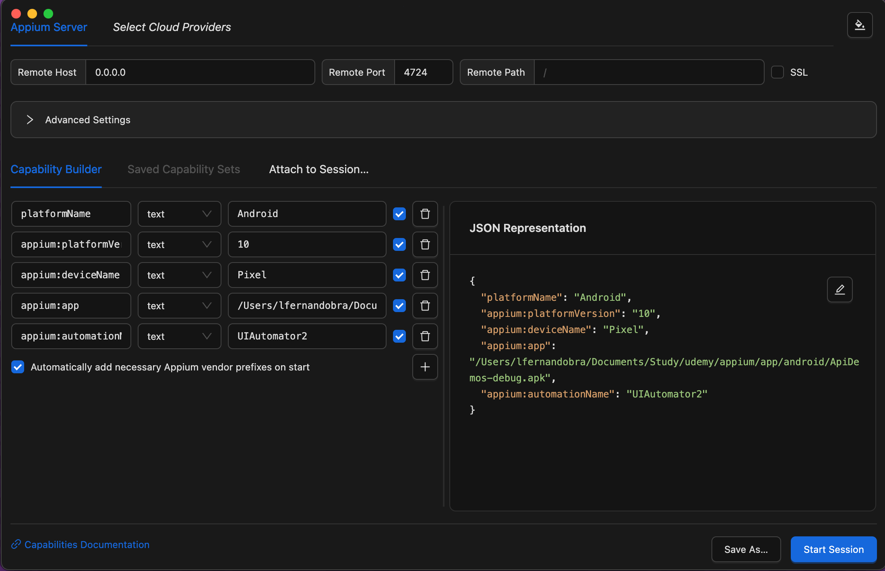
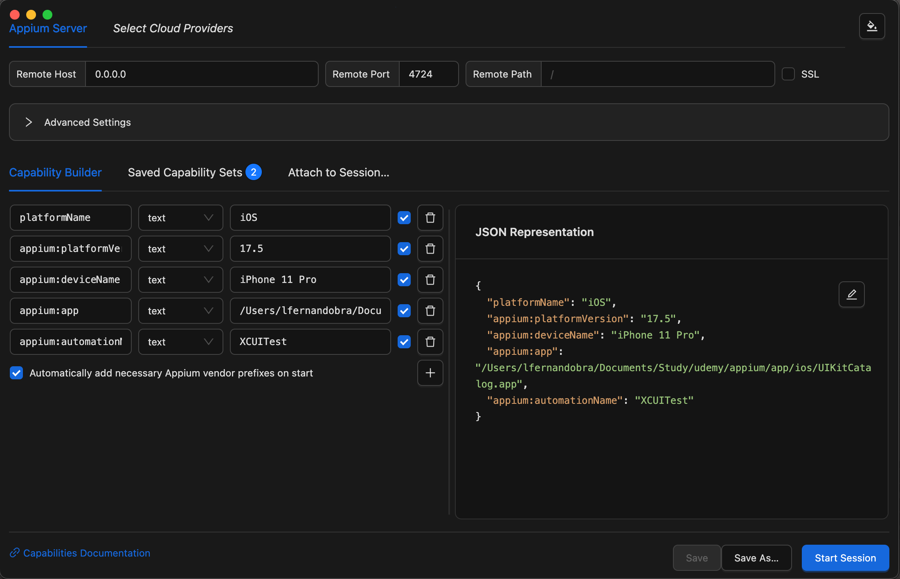

# udemy_appium_course

Appium Setup

WebdriverIO Setup

1 - Create a new project:
    - npm init wide ./{path/to/new/project} 
    - Select “E2E Testing - of Web or Mobile Applications”
    - Select “On my local machine”
    - Select “Mobile - native, hybrid and mobile web apps, on Android or iOS”
    - Select “Android” or “iOS” : Android has selected
    - Select “Mocha” : has selected to follow the course instructions
    - Do you want to use Typescript to write tests? (y/N) : N has selected to follow the course instructions
    - Do you want WebdriverIO to autogenerate some test files? : n has selected to follow the course instructions
    - Which reporter do you want to use? spec has selected to follow the course instructions
    - Do you want to add a plugin to your test setup? No plugin has selected
    - Would you like to include Visual Testing to your setup? For more information see https://webdriver.io/docs/visual-testing! (y/N) : N has selected to follow the course instructions
    - Do you want to add a service to your test setup? appium has selected to follow the course instructions
    - Do you want me to run `npm install` (Y/n) Y
    - Continue with Appium setup using appium-installer (https://github.com/AppiumTestDistribution/appium-installer)? n has selected to follow the course instructions
2 - On the project folder
    - Go to wdio.conf.js, add “'./test/specs/**/*.js'” on spec section

Setup Emulator & Appium Inspector for Testing

# udemy-appium-webdriver

# appium install : npm install -g appium@next
# appium doctor : npm install -g appium-doctor
## checking requirements to run ios : appium-doctor --ios
### install drivers ###
# iOS : appium driver install xcuitest
# Android : appium driver install uiautomator2

# WebdriverIO Setup
## Create a new project:
    - npm init wdio .

===============================
🤖 WDIO Configuration Wizard 🧙
===============================

✔ A project named "udemy-appium-webdriver" was detected at "/Users/lfernandobra/Documents/GitHub/udemy-appium-webdriver", correct? Yes
✔ What type of testing would you like to do? E2E Testing - of Web or Mobile Applications
✔ Where is your automation backend located? On my local machine
✔ Which environment you would like to automate? Mobile - native, hybrid and mobile web apps, on Android or iOS
✔ Which mobile environment you'd like to automate? iOS - applications on iOS, iPadOS, and tvOS
    > using XCTest (https://appium.github.io/appium-xcuitest-driver)
✔ Which framework do you want to use? Mocha (https://mochajs.org/)
✔ Do you want to use Typescript to write tests? No
✔ Do you want WebdriverIO to autogenerate some test files? No
✔ Which reporter do you want to use? spec
✔ Do you want to add a plugin to your test setup? 
✔ Would you like to include Visual Testing to your setup? For more information see https://webdriver.io/docs/visual-testing! No
✔ Do you want to add a service to your test setup? appium
✔ Do you want me to run ⁠ npm install ⁠ Yes
✔ Continue with Appium setup using appium-installer (https://github.com/AppiumTestDistribution/appium-installer)? No

/Users/lfernandobra/Documents/GitHub/udemy-appium-webdriver/app

Setup Linter

eslint-plugin-wdio : npm i eslint-plugin-wdio https://www.npmjs.com/package/eslint-plugin-wdio

 Securing BrowserStack Credentials using dotenv
 npm i dotenv

Create a file named ".env" with browserstack credentials as the sample below
BROWSERSTACK_USER=your_browserstack_username
BROWSERSTACK_KEY=your_browserstack_access_key

Allure Reporter
https://webdriver.io/docs/allure-reporter